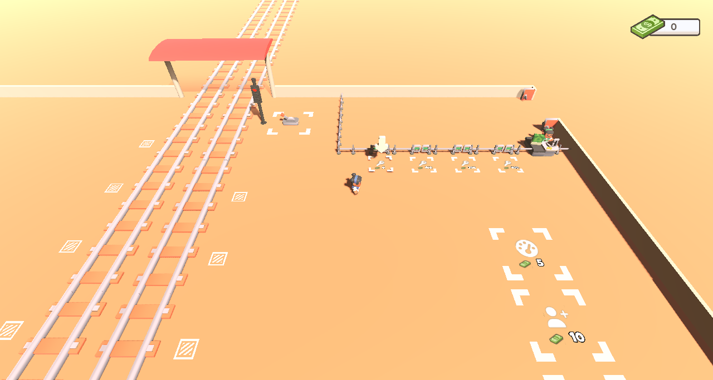
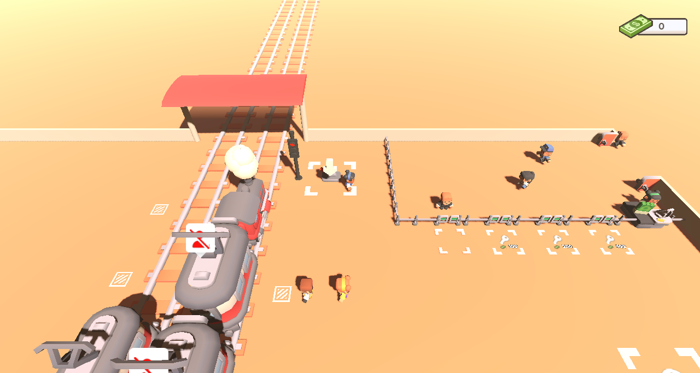
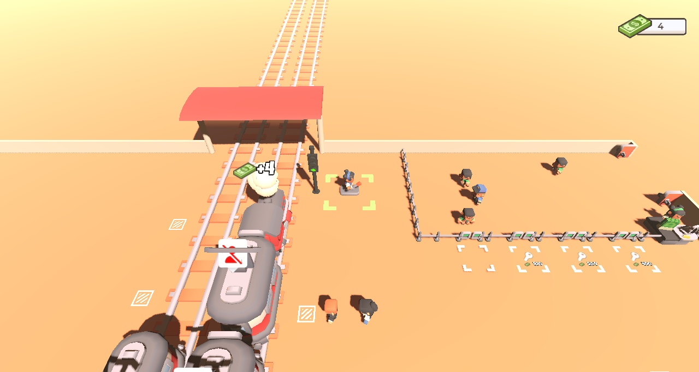
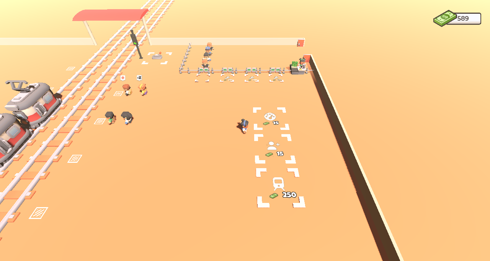

# Train Rush

<p align="center">
  
  
  
  
</p>

An arcade tycoon game: you run a two-platform train station. Open the fence gates so
passengers queue up and board the wagons, then pull the lever to send the train off. Every
passenger pays a ticket, and the coins buy more wagons, more seats and faster trains.

This is the Godot port of the Unity game Train Rush, built as a 3D web game.

> **Vibe coded:** this port was made by prompting an AI coding assistant, not written by hand.
> The code, scenes, converter and docs were generated from prompts, using the Unity game as the
> reference, and checked by playing the game and comparing screenshots rather than by a
> line-by-line code review.

> **Status:** the port is complete: both stations, the train cycle, passengers, upgrades,
> feedback, sound, the tutorial and saving all work like the Unity version. See the
> [roadmap](docs/roadmap.md) for the phases and the open decisions.

## Play

Play the web build in your browser on
[GitHub Pages](https://tiago-xavier-braga.github.io/TrainRushGodot/). The live build lives in
the `gh-pages` branch and is updated by hand, so it can be behind `main`.

## How to play

| Action | Keys |
|---|---|
| Move | `W` `A` `S` `D` / arrow keys / left stick |
| Interact | stand on a floor plate and hold still for 2 seconds |

On touch screens, an on-screen joystick replaces the keys.

- **Gates** — buy a fence gate by holding its plate. Once it's open, stand on its plate to let
  the queued passengers through to the wagons.
- **Train** — when the train stops at the platform, the passengers board. Hold the lever plate
  to send it off: every passenger on board pays 1 coin.
- **Upgrades** — each platform has plates to unlock a wagon, add a seat to every wagon, and
  make the train come back sooner. A plate bobs when you can afford it.

Progress is saved after every purchase, also in the browser.

## Documentation

- [Game design document](docs/gdd.md): the rules, numbers and feedback, plus the Unity quirks
  that were ported or dropped.
- [Roadmap](docs/roadmap.md): the port, phase by phase, and the Unity-to-Godot notes.
- [Playtest feedback](docs/feedback.md): player suggestions and bug reports.

## Requirements

- Godot `4.7` (GL Compatibility renderer)
- [LeafTween](https://github.com/tiago-xavier-braga/LeafTween), the tween library behind every
  animation, already included in `addons/leaf_tween/`
- Save Kit, the save system shared with He Who Loses Wins, already included in
  `addons/save_kit/`

## Run locally

1. Install [Godot 4.7](https://godotengine.org/download).
2. Open `project.godot` in the editor.
3. Press **F5** to play.

## Web build

Install the Godot `4.7` export templates (**Editor → Manage Export Templates**), then export
the `Web` preset from the project folder:

```sh
mkdir -p build
godot --headless --export-release "Web" build/index.html
```

`build/` is git-ignored. Thread support is off, so the build doesn't need cross-origin
isolation headers and runs on static hosts such as GitHub Pages.

To publish, commit the contents of `build/` (plus an empty `.nojekyll`) to the `gh-pages`
branch and push it. GitHub Pages serves that branch from its root.

## Porting from Unity

The Unity project, [TrainRush](https://github.com/tiago-xavier-braga/TrainRush), is the
reference for the port. It isn't part of this repository: clone it into `unity/TrainRush/`
(git-ignored) to use the converter in `tools/unity_port/`, which reads the Unity scenes and
generates the environment scenes, the train and wagon models and the station layout. It needs Python with `pyyaml` and `numpy`:

```sh
python tools/unity_port/gen_godot.py
```

It overwrites the scenes it generates; the gameplay scenes and scripts are written by hand.

## License

The source code is licensed under the [GNU GPL v3.0](LICENSE).
[LeafTween](https://github.com/tiago-xavier-braga/LeafTween), in `addons/leaf_tween/`, is
licensed under MIT.

Third-party assets keep their own licenses:

- The 3D models in `assets/models/kenney_*` are by [Kenney](https://www.kenney.nl) and released
  under CC0 (each kit's `license.txt` is next to its models).
- [Luckiest Guy](assets/fonts/luckiest_guy_license.txt) is licensed under the Apache License 2.0.
- [Montserrat](assets/fonts/montserrat_license.txt) is licensed under the SIL Open Font License
  1.1.

The other art (traffic light, money, arrow and smoke models, UI textures), the sounds and the
music come from the original Unity project and are not covered by the GPL.
